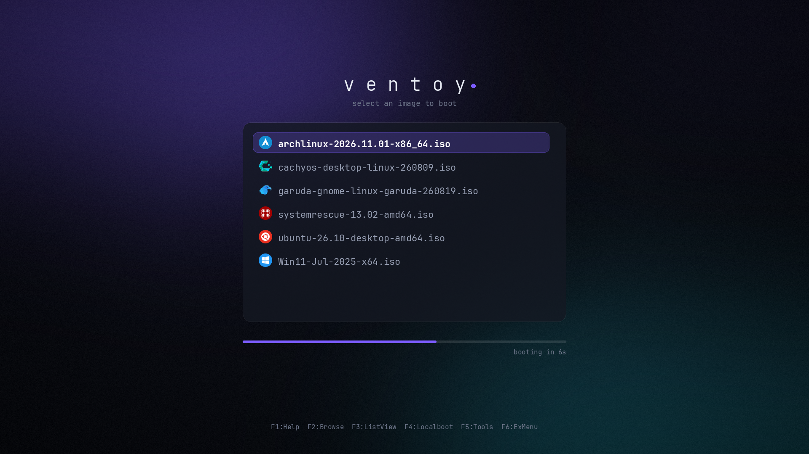

# ventoy.json

## Introduction

[Ventoy](https://www.ventoy.net/en/index.html) is a bootable USB solution that supports multiple ISO in a single
flash drive and here is my configuration for it to have theme and also support different operating systems
and distributions images.

```
├─ 📂 drivers
|
├─ 📂 iso
|  ├─ 📂 linux
|  └─ 📂 windows
|
|
└ 📂 ventoy/
  ├─ .git/
  ├─ {} ventoy.json
  ├─ 🖹 README.md
  ├─ 📂 scripts/
  ├─ 📂 docs/
  └─ 📂 theme/nova/
```

## Images

- [Arch](https://archlinux.org/)
- [Bodhi Linux](https://www.bodhilinux.com/)
- [CachyOS](https://cachyos.org/)
- [EndeavourOS](https://endeavouros.com/)
- [Fedora](https://fedoraproject.org/)
- [Garuda Linux](https://garudalinux.org/index.html)
- [Gentoo](https://www.gentoo.org/)
- [Manjaro](https://manjaro.org/)
- [Linux Mint](https://linuxmint.com/)
- [NixOS](https://nixos.org/)
- [System Rescue](https://www.system-rescue.org/)
- [Tails](https://tails.boum.org/index.en.html)
- [Ubuntu](https://ubuntu.com/)
- [VMware ESXi](https://www.vmware.com/products/esxi-and-esx.html)
- [Void Linux](https://voidlinux.org/)
- Windows

## Theme

The theme is **Nova**, a minimal dark theme in `theme/nova/`: a centered translucent card with the image list, a violet selection pill, a slim auto-boot countdown bar, and Ventoy's live hotkey hints at the bottom. The distro icons come from the [Dark Matter GRUB Theme](https://github.com/VandalByte/darkmatter-grub2-theme) and the font is [JetBrains Mono](https://www.jetbrains.com/lp/mono/) (OFL).



The background, the 9-slice pixmaps and the `.pf2` fonts are generated by `scripts/build_theme.py`, so change colors or layout there and rebuild instead of editing the PNGs:

```sh
# macOS: brew install x86_64-elf-grub   (Linux: grub-mkfont from the grub package)
python3 scripts/build_theme.py --preview   # needs Pillow + numpy
python3 -I scripts/validate.py
```

The preview is an approximation drawn with Pillow, not a GRUB screenshot.
